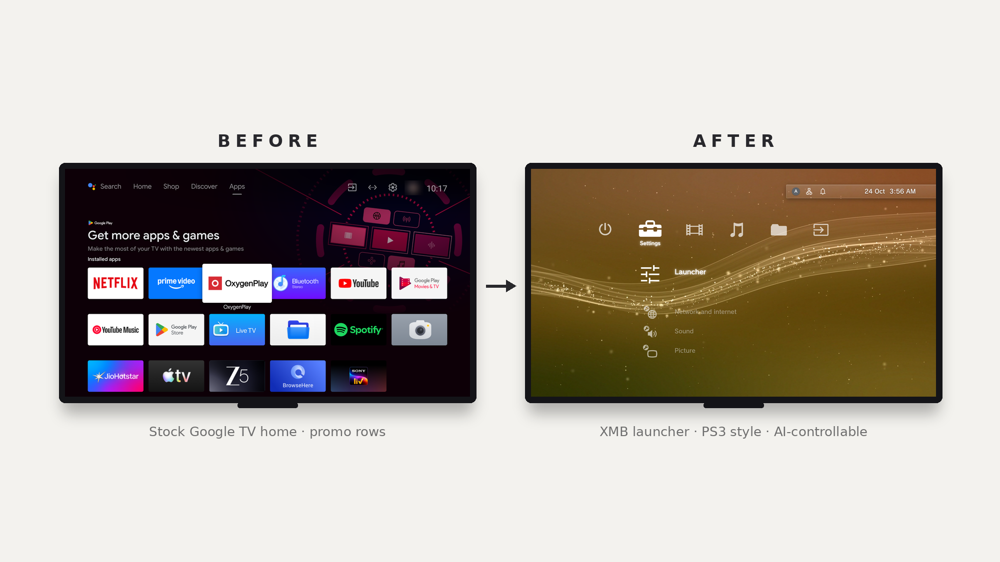
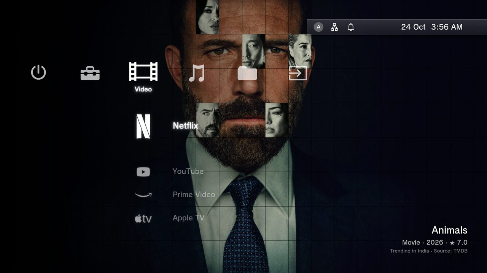
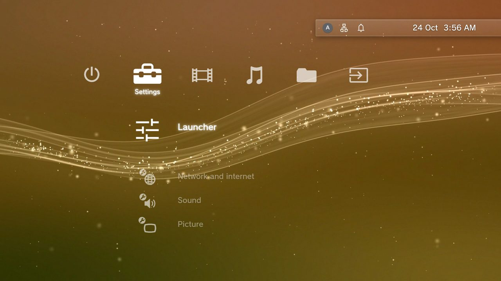
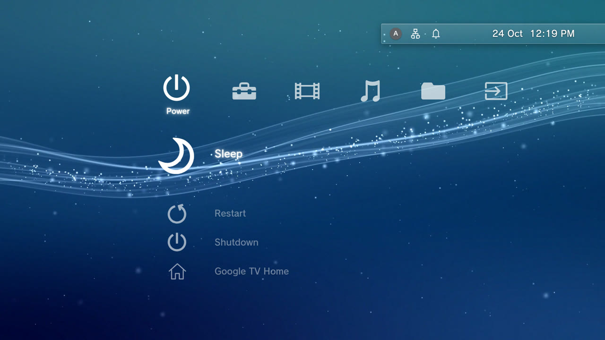
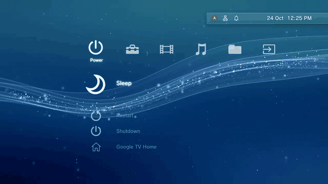
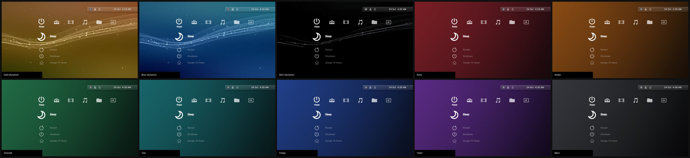

<h1 align="center">XMB TV Home</h1>
<hr>
<p align="center"><b>The PlayStation 3 home screen, on your Android TV.</b> Fast, clean and ad-free. Disable the bloat, install the XMB, and let your AI agent run it.</p>
<p align="center">
<a href="https://github.com/sanangoyal/xmb-tv-launcher/releases/latest"></a>
<a href="LICENSE"></a>


</p>
<p align="center"><a href="#install">Install</a> · <a href="#screenshots">Screenshots</a> · <a href="#how-it-works">How it works</a> · <a href="#ai-control-mcp">AI control</a> · <a href="#compatibility">Compatibility</a> · <a href="#safety-and-undo">Safety</a> · <a href="#build-from-source">Build</a></p>
<hr>

<p align="center"></p>

<p align="center">Made by <a href="https://sanangoyal.com">Sanan Goyal</a> · MIT licence · Third-party material: <a href="ASSETS.md">ASSETS.md</a></p>

## Features

| | | |
|---|---|---|
| 🎮 **Classic PS3 XMB**<br><sub>Horizontal categories, vertical items, glowing ribbon. The one you remember.</sub> | ⚡ **Built for slow TVs**<br><sub>Tuned for 2 GB of RAM. Static mode draws once and idles at zero redraws.</sub> | 🌊 **Live backgrounds**<br><sub>Looping ribbon in gold, blue or dark. Colour follows the time of day.</sub> |
| 🔊 **Real XMB sounds**<br><sub>Authentic navigation audio, plus soft ambient music after 5 minutes idle.</sub> | 🤖 **AI-controllable**<br><sub>Built-in MCP server. Agents change settings, press keys and take screenshots.</sub> | 🎨 **Yours to change**<br><sub>Colours, solid themes, your own image, music volume. All on the TV.</sub> |
| 🧩 **Clean, consistent icons**<br><sub>Real brand logos for your apps, one glyph style for the rest.</sub> | 🧹 **No bloat, no ads**<br><sub>Disables promo apps and ad services. Never uninstalls. Full restore script.</sub> | 🎬 **Movie scenes**<br><sub>Trending titles from TMDB fill the screen behind your apps.</sub> |

The UI stays on: it is its own screensaver.

## Screenshots

| | |
|---|---|
| <br><sub>Movie scenes behind your apps</sub> | <br><sub>Launcher settings, on the TV</sub> |
| <br><sub>Dynamic gold ribbon, PS3 style</sub> | <br><sub>Navigation</sub> |

### Colours

Gold, blue and dark are animated videos (Dynamic) or still images (Static). The solid colours are static gradients.



## How it works

1. **Connect.** Turn on USB debugging on the TV and connect over Wi-Fi with `adb`. No root, no cable.
2. **Back up.** Package list, settings, current home app and a screenshot are saved first.
3. **Disable the junk.** Ad services, promo apps and vendor extras are switched off with `pm disable-user`. Nothing is uninstalled, and a restore script undoes every step.
4. **Install XMB TV Home.** The APK is installed, its permissions granted, and it becomes your home screen.
5. **Verify.** Each step is checked with a TV screenshot before the next one.

## Install

### Easiest: let your AI do it

Needs a coding agent with shell access (Claude Code, Codex, Gemini CLI, Cursor...) on a computer on the same Wi-Fi as the TV, with `adb` installed. Either clone the repo, open your agent inside it, and tell it to follow [`PROMPT.md`](PROMPT.md), or just paste:

```
Read https://github.com/sanangoyal/xmb-tv-launcher and follow PROMPT.md and skill/SKILL.md.
My Android TV is at <TV IP>. Back it up first, show me the bloatware you plan to
disable and ask before each group, install XMB TV Home, grant its permissions,
make it my home screen, and confirm with a screenshot. Ask before anything destructive.
Keep a restore script.
```

That is all. The agent connects over ADB, backs up, debloats, installs, verifies. The skill in `skill/` tells it exactly how.

### Custom install (manual)

1. **TV:** Settings > Device Preferences > About > tap *Build* 7 times. Then Developer options > enable *USB debugging* / *Network debugging*. Note the TV's IP (Network settings).
2. **Computer:** install `adb` (macOS `brew install android-platform-tools`, Linux `apt install adb`, Windows: platform-tools zip).
3. **Connect** (accept the prompt on the TV):

```
adb connect <TV-IP>:5555
adb devices
```

4. **Back up** (always):

```
scripts/backup.sh <TV-IP>
```

5. **Debloat** (optional; disables, does not uninstall; edit `scripts/bloat-oneplus-tv.txt` first for other brands):

```
scripts/debloat.sh <TV-IP>          # writes restore-bloat.sh
```

6. **Get the APK:** download `xmb-launcher.apk` from Releases, or build it (below).
7. **Install and grant:**

```
scripts/install.sh <TV-IP> xmb-launcher.apk
```

8. **Make it home:** press Home on the remote, pick *XMB*, choose *Always*. If the stock launcher keeps winning:

```
adb shell pm disable-user --user 0 com.google.android.tvlauncher
```

9. **Undo everything:** `scripts/restore-launcher.sh <TV-IP>` and `./restore-bloat.sh`.

## Compatibility

| Platform | Status |
|---|---|
| Android TV, Google TV (Android 9+) | Supported |
| Fire TV | Not supported. Fire OS blocks third-party home screens |
| Samsung (Tizen), LG (webOS) | Not supported. Different operating systems |

Tested on OnePlus TV 55 Y1S Pro (Android 11, 1080p, 2 GB RAM). Some China-market sets refuse any third-party launcher. If you try another model, [open an issue](https://github.com/sanangoyal/xmb-tv-launcher/issues) with the model name and what happened.

## Safety and undo

- Back up first: `scripts/backup.sh` runs before any change.
- Disable, never uninstall. Every disabled package is written to `restore-bloat.sh`.
- The stock home screen is only disabled after XMB TV Home is confirmed working. If anything looks wrong, run `scripts/restore-launcher.sh <TV-IP>`.
- Turn ADB off when you are done: see [SECURITY.md](SECURITY.md).

## Tools

All in `scripts/`. Each takes the TV address (`<TV-IP>` or `<TV-IP>:port`).

| Script | What it does |
|---|---|
| `backup.sh` | Snapshots packages, settings, current home app and a screenshot before any change |
| `debloat.sh` | Disables the packages on a list and writes `restore-bloat.sh` |
| `install.sh` | Installs the APK and grants its permissions |
| `check.sh` | After a firmware update: confirms XMB TV Home is still Home and lists packages the update re-enabled. `--fix` disables them again |
| `privacy.sh` | Read-only audit of voice, content-recognition (ACR), telemetry and ad packages, and which apps can use the microphone |
| `adb-closed.sh` | Turns network ADB off and confirms the port no longer answers. Run it when you are done |
| `restore-launcher.sh` | Brings the stock home screen back |

## Settings (on the TV: Settings > Launcher)

| Item | Options |
|---|---|
| Background | Static (lightest), Dynamic (video) |
| Color | Auto (blue morning, gold afternoon and evening, dark night), Random (each load and every 30 min), Gold, Blue, Dark, Custom image |
| Solid colour | Black, Ruby, Amber, Emerald, Teal, Indigo, Violet (static) |
| Choose custom image | File browser: TV storage or USB (static) |
| Ambient music | Off, Soft, Medium, Loud (plays after 5 min idle, stops on any key) |
| Agent control | On/Off, shows address and token, New token |
| About | Credits, licence, disclaimers |

## AI control (MCP)

Settings > Launcher > Agent control > On. The TV shows the endpoint and a token.

```
URL:     http://<TV-IP>:8765/mcp
Header:  Authorization: Bearer <token>
```

Add it to any MCP client (HTTP transport). Tools: `status`, `get_settings`, `set_setting`, `press_key`, `list_apps`, `open_app`, `screenshot`.

Quick test:

```
curl -s -H "Authorization: Bearer <token>" -H "Content-Type: application/json" \
  -d '{"jsonrpc":"2.0","id":1,"method":"tools/call","params":{"name":"get_settings","arguments":{}}}' \
  http://<TV-IP>:8765/mcp
```

Off by default. LAN only: do not expose the port to the internet. Without it, agents can still use `adb shell am start -n com.sanan.xmb/.MainActivity --es js '<javascript>'`.

## Build from source

Needs JDK 8+, Android SDK (`platforms/android-30`, build-tools 34), the R8 jar, Python 3, `zip`.

```
echo YOUR_TMDB_V3_KEY > android/tmdb.key     # free key from themoviedb.org
export ANDROID_HOME=/path/to/sdk R8_JAR=/path/to/r8.jar
bash android/build.sh                          # -> android/out/xmb-launcher.apk
```

`tools/mk.py` assembles the UI (`web/xmb.tpl.html` + icon, logo and sound data) into the app. Docs: [docs/DESIGN.md](docs/DESIGN.md), [docs/TECH.md](docs/TECH.md).

## For AI agents

Start at [`skill/SKILL.md`](skill/SKILL.md). It covers connecting to the TV, backup, safe debloating, installing this launcher, and using it as an example for building your own custom TV UI.

## Credits

Debloat approach and agent prompt style inspired by [cleanyourtv](https://github.com/Gathin23/cleanyourtv) by Gathin23 and [tv-home](https://github.com/mihirgupta0900/tv-home) by mihirgupta0900. Movie data: TMDB.

## Disclaimer

Provided as is, no warranty. Use at your own risk; the author is not liable for damage, data loss, bricked or misbehaving devices. Disabling system apps can break TV features: back up first and keep the restore scripts. Personal, non-commercial use intended.

Not affiliated with Sony, Google, Netflix, Amazon, Apple, YouTube, Spotify or any app shown. "PlayStation" and "XMB" are trademarks of Sony Interactive Entertainment. Movie data and images courtesy of TMDB; this product uses the TMDB API but is not endorsed or certified by TMDB. Rights holders: see [ASSETS.md](ASSETS.md).

## Licence

MIT. See [LICENSE](LICENSE). Copyright (c) 2026 Sanan Goyal.
